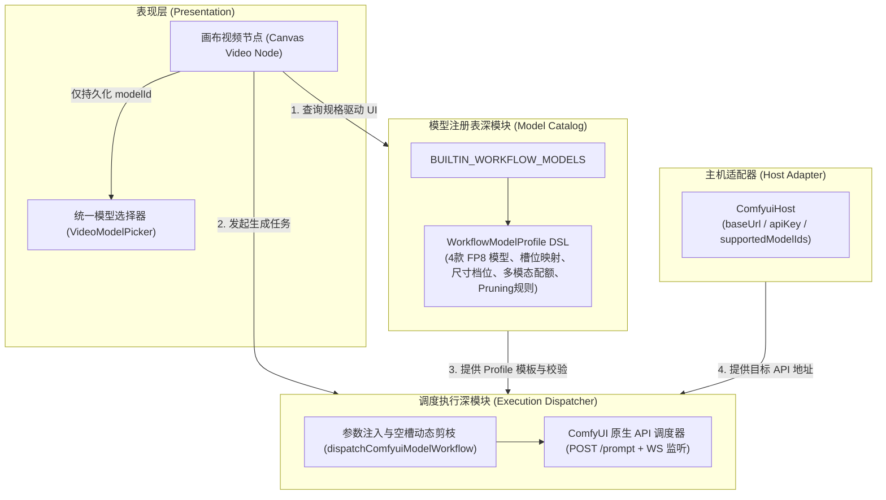
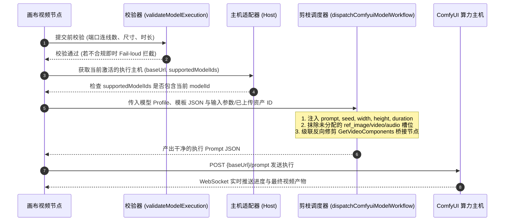

# 工作流模型 (DSL) 与执行主机 (API) 架构解耦规范

本文档定义本项目将 **执行主机（Host / API 地址）** 与 **工作流模型（Model / DSL）** 彻底解耦的系统架构标准与实施方案。

---

## 1. 系统现状分析与重构动机

### 1.1 现存架构痛点（浅模块与跨缝泄漏）

在现有实现中，系统将“渠道（Channel）”作为混合容器，导致了多重架构痛点：

1. **主机与工作流数据混杂膨胀**：
   `ModelChannel` 中既保存底层的 API 地址（`baseUrl`）、反代密钥（`apiKey` / `proxyToken`），又内嵌深拷贝了整整 17 份完整的 ComfyUI 工作流 JSON 结构。每添加一台算力主机，工作流状态树就会被全量克隆一遍。
2. **状态四重映射与心智负担**：
   在画布视频节点中，调用方为了选定一个视频生成规格，需要同时协调并保持 `channelId`、`workflowId`、`videoMode`（`"omni"` 或 `"frame"`）以及 `modelId` 4 个字段的状态同步，并在多个浮层组件间反复转换。
3. **调度执行层 5 重回退分支**：
   在 `generateComfyuiVideo` 执行入口处，为了找到应该运行的工作流 JSON，存在 5 级深度嵌套的尝试与回退查找，接口表面积过大且缺乏确定性。
4. **模型冗余与极端硬件门槛**：
   早期引入的 BF16 模型（8 步 Turbo / 20 步高精）需要 48G~80G 的极端算力显存，不符合主流创作者环境，增加了维护复杂度与选择困惑。

### 1.2 解耦核心原则

- **主机（Host / API Endpoint）= 算力执行环境（Where to run）**：
  纯网络与鉴权配置（地址、密钥、在线状态），不内嵌任何工作流业务逻辑。
- **模型（Model / Workflow DSL）= 业务能力与调度契约（What to run）**：
  每一个工作流都是一个一等公民能力模型。拥有声明式的 Profile（参数边界、多模态配额、硬件锁死规格、ComfyUI 槽位映射与修剪规则）。
- **全面收敛为 FP8 精品模型**：
  彻底移除高门槛的 BF16 模型，系统视频能力全面聚焦于经过深度优化的 4 款 MiniMax H3 FP8 模型（2 款全能参考 + 2 款首尾帧）。
- **显存客观分级与分镜时长指引**：
  剥离具体显卡硬件型号，依据实际运行显存占用，明确规范 8G / 16G / 24G / 32G 显存阶梯与单次分镜推荐时长。
- **画布节点（Canvas Node）= 纯声明式调用者**：
  节点仅记录绑定的 `modelId`，其界面渲染（连线端口限制、16:9/9:16 对称 9 档尺寸卡片、1~15s 时长滑杆）完全由该模型的 DSL 动态自适应驱动。

---

## 2. 领域架构模型与缝合线划分



---

## 3. MiniMax H3 视频 4 大 FP8 模型全景矩阵

系统内置视频工作流全面收敛为 **4 个独立的 FP8 工作流模型 Profile**。所有模型共享 MiniMax H3 硬件严格对齐规范（16:9 与 9:16 对称互调，0.2M~0.98M 9 档像素锁死；1~15s 线性时长）。

| 模型 ID | 模型显示名称 | 模态族群 | 采样步数 | 权重精度 | 多模态参考资源上限 | 推荐显存门槛 | 核心特性与推荐场景 |
| :--- | :--- | :--- | :--- | :--- | :--- | :--- | :--- |
| `omni-video-minimax-h3-fp8-4step-pdmd` | MiniMax H3 全能 (FP8 4步 极速) | 全能参考 (Omni) | 4 步 (PDMD) | FP8 Scaled | 9 图 + 3 视 + 3 音 | 8GB / 16GB+ | **默认主推极速出片**，集成 EasyCache 特征缓存，适合快速验证创意 |
| `omni-video-minimax-h3-fp8` | MiniMax H3 全能 (FP8 20步 标准) | 全能参考 (Omni) | 20 步 | FP8 Scaled | 9 图 + 3 视 + 3 音 | 16GB / 24GB+ | 高保真稳定出片，细节更丰富，光影演化更自然 |
| `frame-video-minimax-h3-fp8-4step-pdmd` | MiniMax H3 首尾帧 (FP8 4步 极速) | 首尾插值 (Frame) | 4 步 (PDMD) | FP8 Scaled | 严格首尾 2 图（无视音频） | 8GB / 16GB+ | **默认首尾极速插值**，仅需 4 步瞬间成片，适合快速动作演化 |
| `frame-video-minimax-h3-fp8` | MiniMax H3 首尾帧 (FP8 20步 标准) | 首尾插值 (Frame) | 20 步 | FP8 Scaled | 严格首尾 2 图（无视音频） | 16GB / 24GB+ | 首尾过渡细腻平滑，边缘形变控制更佳 |

---

## 4. 显存梯度与单次分镜推荐时长矩阵

为了消除创作者对硬件显存门槛与生成时长匹配的困惑，系统建立客观的显存-时长指导基准：

| 显存梯度 | 推荐单次分镜时长 | 最大安全上限 | 运行状态与体验特征 | 典型分镜应用场景 |
| :--- | :--- | :--- | :--- | :--- |
| **8G 显存** | **3s ~ 5s** | **5s** | 依赖 ComfyUI 模型内存切片（CPU Offload），生成 5s 以内最稳定，不易触发虚拟内存颠簸 | **快速短分镜、首尾动作极速过渡、短平快创意验证** |
| **16G 显存** | **5s ~ 8s** | **10s** | FP8 权重全量载入显存，显卡计算单元满血运转，5s ~ 8s 渲染最流畅 | **影视标准单分镜黄金时长、特写人物表情、标准镜头叙事** |
| **24G 显存** | **8s ~ 12s** | **12s** | 显存空间充裕，多模态（9图+3视+3音）参考注意力缓存无溢出风险，轻松驾驭长镜头 | **复杂推拉摇移运镜、角色连续动作、多参考综合长镜头** |
| **32G 显存** | **12s ~ 15s** | **15s（打满极限）** | 显存无瓶颈，打满 MiniMax H3 单镜头 15 秒规格上限，支持 EasyCache 特征全缓存 | **超长镜头一镜到底、完整广告微段落、长景深演变镜头** |

> [!TIP]
> 画布节点的时长滑块预设快捷胶囊 `[5s, 10s, 15s]` 精准对齐了这一梯度：`5s`（8G/16G 基础）、`10s`（24G 标准长镜头）、`15s`（32G 极限长镜头）。

---

## 5. 主机支持模型机制设计 (`supportedModelIds`)

### 5.1 数据模型契约
```ts
export interface ComfyuiHost {
    id: string;
    name: string;                   // 主机标识，如 "本地 16G 极速机"
    baseUrl: string;                // API 地址，如 "http://127.0.0.1:8188"
    apiKey?: string;                // 可选的反代鉴权 Token
    // 该主机支持的模型 ID 集合
    // 为空或 undefined 时默认全支持（零配置开箱即用原则）
    supportedModelIds?: string[];
}
```

### 5.2 交互联动与防呆规则
1. **全局设置面板**：用户配置主机时，可勾选支持的 4 大 FP8 模型（默认全选）。
2. **画布节点实时感知**：
   - 当节点选中的模型不在当前激活主机的 `supportedModelIds` 中时，模型卡片显示微标记：`⚠️ 当前主机未就绪`。
   - 点击生成时执行 Fail-loud 拦截提示：`「当前主机」未启用该模型，请在设置中开启或切换主机`。
3. **插件缺失友好提示**：
   - 当 ComfyUI 返回 `Prompt outputs failed validation` 错误时，拦截并翻译为具体的缺失插件中文指引弹窗，避免技术黑话。

---

## 6. 执行与动态剪枝调度契约



---

## 7. 实施步骤清单

1. **第一阶段：模型层规范化（收敛为 4 个 FP8 模型）**
   - 移除 BF16 8 步 Turbo 与 BF16 20 步模型定义；
   - 在 `models/` 下创建 4 个 discrete FP8 Profile；
   - 标注 `vramTier`（8GB / 16GB / 24GB / 32GB）与时长推荐；
   - 更新单元测试，确保 4 大模型剪枝与校验 100% 通过。
2. **第二阶段：主机层（Channel）解耦**
   - 重构 `use-config-store.ts`，精简 Host 为纯网络配置并引入 `supportedModelIds`；
   - 保持生图与音频通道的兼容透传。
3. **第三阶段：画布视频节点折叠重构**
   - 移除 `ChannelWorkflowPicker` 视频分支；
   - 构建单一 `modelId` 驱动的 `VideoModelPicker` 卡片与快捷胶囊；
   - 集成主机支持状态校验与友好报错。
4. **第四阶段：执行层统一收口**
   - 统一由深模块收口多模态并发上传与执行，彻底消灭历史 5 重回退分支。
