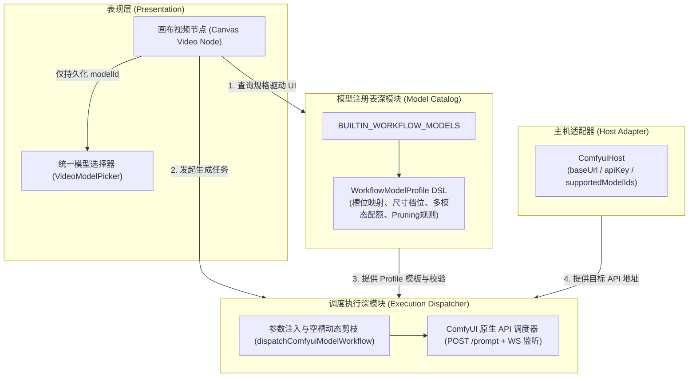
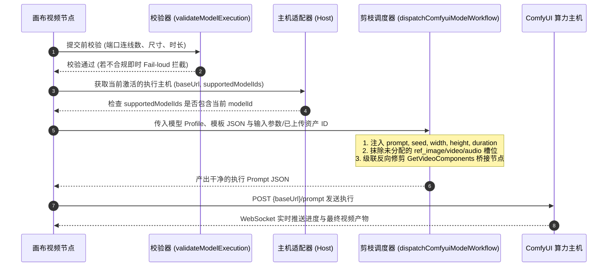

# 工作流模型 (DSL) 与执行主机 (API) 架构解耦规范

本文档定义本项目将 **执行主机（Host / API 地址）** 与 **工作流模型（Model / DSL）** 彻底解耦的系统架构标准与实施方案。

---

## 1. 系统现状分析与重构动机

### 1.1 现存架构痛点（浅模块与跨缝泄漏）

在现有实现中，系统将“渠道（Channel）”作为混合容器，导致了多重严重的架构痛点：

1. **主机与工作流数据混杂膨胀**：
   `ModelChannel` 中既保存了底层的 API 地址（`baseUrl`）、反代密钥（`apiKey` / `proxyToken`），又内嵌深拷贝了整整 17 份完整的 ComfyUI 工作流 JSON 结构（包括文生图、图生图、视频、首尾帧等）。只要用户添加一台算力主机，整个工作流状态树就会被全量克隆一遍。
2. **状态四重映射与心智负担**：
   在画布视频节点中，调用方为了选定一个视频生成规格，需要同时协调并保持 `channelId`、`workflowId`、`videoMode`（`"omni"` 或 `"frame"`）以及 `modelId` 4 个字段的状态同步，并在多个浮层组件间反复转换。
3. **调度执行层 5 重回退分支**：
   在 `generateComfyuiVideo` 执行入口处，为了找到应该运行的工作流 JSON，存在 5 级深度嵌套的尝试与回退查找（从 `channel.models`、`channelModel.comfyuiWorkflow`、`channel.comfyuiVideoWorkflow` 到内置兜底），接口表面积过大且缺乏确定性。

### 1.2 解耦核心原则

- **主机（Host / API Endpoint）= 算力执行环境（Where to run）**：
  纯网络与鉴权配置（地址、密钥、在线状态），不内嵌任何工作流业务逻辑。
- **模型（Model / Workflow DSL）= 业务能力与调度契约（What to run）**：
  每一个工作流都是一个一等公民能力模型。拥有声明式的 Profile（参数边界、多模态配额、硬件锁死规格、ComfyUI 槽位映射与修剪规则）。
- **画布节点（Canvas Node）= 纯声明式调用者**：
  节点仅记录绑定的 `modelId`，其界面渲染（连线端口限制、16:9/9:16 对称 9 档尺寸卡片、1~15s 时长滑杆）完全由该模型的 DSL 动态自适应驱动。

---

## 2. 领域架构模型与缝合线划分



---

## 3. MiniMax H3 视频 8 模型全景矩阵

系统内置的 8 条 MiniMax H3 工作流全面升格为 **8 个独立的工作流模型 Profile**。所有模型共享 MiniMax H3 硬件严格对齐规范（16:9 与 9:16 对称互调，0.2M~0.98M 9 档像素锁死；1~15s 线性时长）。

| 模型 ID | 模型显示名称 | 模态族群 | 采样步数 | 权重精度 | 多模态参考资源上限 | 推荐显存 (VRAM) | 适用场景 |
| :--- | :--- | :--- | :--- | :--- | :--- | :--- | :--- |
| `omni-video-minimax-h3-fp8-4step-pdmd` | MiniMax H3 全能 (FP8 4步 极速) | 全能参考 (Omni) | 4 步 (PDMD) | FP8 Scaled | 9 图 + 3 视 + 3 音 | 16GB+ (RTX 4090 / 3090) | **默认极速出片**，快速验证创意 |
| `omni-video-minimax-h3-fp8` | MiniMax H3 全能 (FP8 20步 标准) | 全能参考 (Omni) | 20 步 | FP8 Scaled | 9 图 + 3 视 + 3 音 | 16GB+ (RTX 4090 / 3090) | 消费级显卡下的高质量稳定生成 |
| `omni-video-minimax-h3-bf16-turbo` | MiniMax H3 全能 (BF16 8步 Turbo) | 全能参考 (Omni) | 8 步 (Turbo) | BF16 原生 | 9 图 + 3 视 + 3 音 | 24GB~48GB (A6000 / RTX 6000 Ada) | 高性能显卡下的高速高保真出片 |
| `omni-video-minimax-h3-bf16-20step` | MiniMax H3 全能 (BF16 20步 高精) | 全能参考 (Omni) | 20 步 | BF16 原生 | 9 图 + 3 视 + 3 音 | 48GB~80GB (A100 / H100 / 8000) | **画质上限最高**，商业级成片渲染 |
| `frame-video-minimax-h3-fp8-4step-pdmd` | MiniMax H3 首尾帧 (FP8 4步 极速) | 首尾插值 (Frame) | 4 步 (PDMD) | FP8 Scaled | 严格首尾 2 图（无视音频） | 16GB+ (RTX 4090 / 3090) | **默认首尾极速插值**，瞬间演化 |
| `frame-video-minimax-h3-fp8` | MiniMax H3 首尾帧 (FP8 20步 标准) | 首尾插值 (Frame) | 20 步 | FP8 Scaled | 严格首尾 2 图（无视音频） | 16GB+ (RTX 4090 / 3090) | 首尾过渡平滑，消费级显卡可用 |
| `frame-video-minimax-h3-bf16-turbo` | MiniMax H3 首尾帧 (BF16 8步 Turbo) | 首尾插值 (Frame) | 8 步 (Turbo) | BF16 原生 | 严格首尾 2 图（无视音频） | 24GB~48GB | 首尾高清过渡，步数精简 |
| `frame-video-minimax-h3-bf16-20step` | MiniMax H3 首尾帧 (BF16 20步 高精) | 首尾插值 (Frame) | 20 步 | BF16 原生 | 严格首尾 2 图（无视音频） | 48GB~80GB | 极高保真光影与细节动态补帧 |

---

## 4. 主机支持模型机制设计 (`supportedModelIds`)

### 4.1 现实痛点与必要性
在生产中，不同的 ComfyUI 运行主机由于物理显卡和本地磁盘差异，并非全部都能运行上述 8 个模型：
- **显存屏障 (OOM)**：16G 显存主机运行 BF16 20 步会在 KSampler 步骤直接引发 CUDA OOM 崩溃。
- **权重缺失 (FileNotFound)**：主机 ComfyUI 实例可能只拉取了 FP8 权重，没有下载 BF16 模型。

### 4.2 极简设计规范

#### 主机数据模型契约
```ts
export interface ComfyuiHost {
    id: string;
    name: string;                   // 主机标识，如 "本地 4090 极速机"
    baseUrl: string;                // API 地址，如 "http://127.0.0.1:8188"
    apiKey?: string;                // 可选的反代鉴权 Token
    // 该主机支持的模型 ID 集合
    // 为空或 undefined 时默认全支持（零配置开箱即用原则）
    supportedModelIds?: string[];
}
```

#### 交互联动与防呆规则
1. **全局设置面板**：用户添加或编辑主机时，可查看 8 大模型开关。默认全开；低显存机器可一键关掉 BF16 族群。
2. **画布节点实时感知**：
   - 当节点选中的模型不在当前激活主机的 `supportedModelIds` 中时，模型卡片显示微标记：`⚠️ 当前主机未就绪`。
   - 点击生成时执行 Fail-loud 拦截提示：`「当前主机」未启用该模型，请在设置中开启或切换至高配主机`。

---

## 5. 执行与动态剪枝调度契约



---

## 6. 重构实施步骤清单

1. **第一阶段：模型层补齐 8 大 MiniMax H3 独立 Profiles**
   - 在 `web/src/services/api/models/` 下创建 8 个 discrete Profile 定义。
   - 包含明确的精度、步数、多模态参考配额与槽位映射。
   - 编写模型测试覆盖 8 大模型解析与参数剪枝。
2. **第二阶段：主机层（Channel）解耦瘦身**
   - 重构 `use-config-store.ts`，彻底移除渠道对象中的 17 套冗余工作流 JSON 深度拷贝。
   - 引入 `supportedModelIds` 字段支持主机能力声明。
3. **第三阶段：画布视频节点折叠重构**
   - 在 `canvas-node-prompt-panel.tsx` 中移除复杂的 `ChannelWorkflowPicker` 视频多级穿透。
   - 替换为基于 `modelId` 直接驱动的扁平卡片选择器 `VideoModelPicker`。
4. **第四阶段：执行层收敛消除 5 级回退**
   - 统一由 `dispatchModelExecution(host, modelProfile, params)` 收口多模态上传与执行，彻底消灭历史废弃分支。
